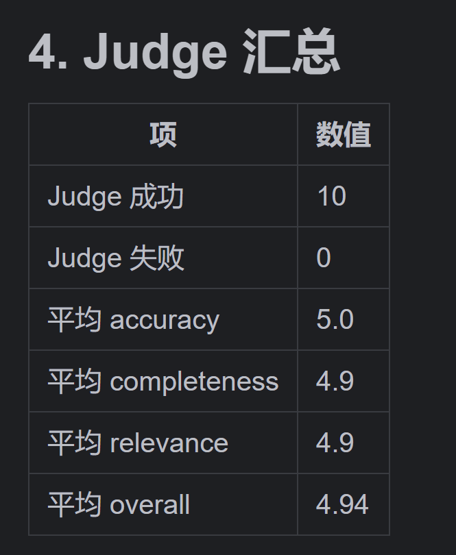
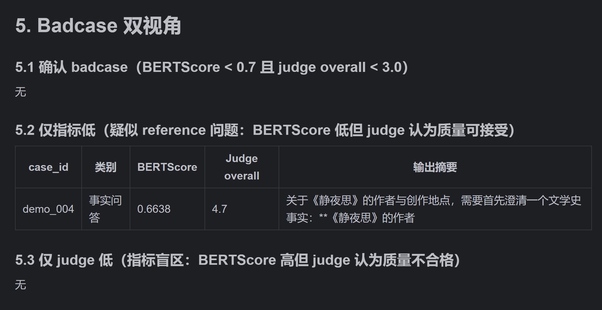
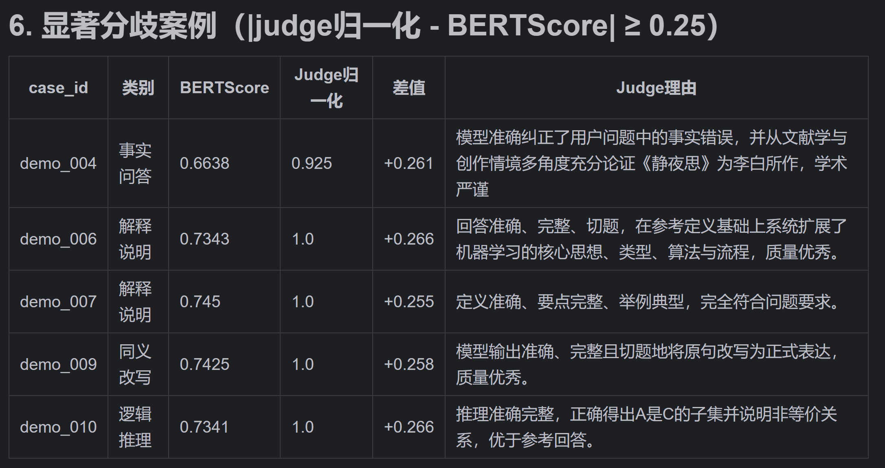

# ai-eval

面向 LLM 服务质量验收与版本回归的自动化评测平台。

## 项目背景

大模型（LLM）的输出具有非确定性，没有唯一的标准答案，传统接口测试的 `assert code == 200` 无法直接套用。在模型版本迭代、Prompt 调优或 RAG 链路更新时，团队需要一套可重复、可量化的评测流程来回答三个核心问题：

1. **质量是否退化？** 新版本相比旧版本，整体输出质量有没有下降？
2. **具体哪里退化了？** 是事实错误、信息遗漏，还是语义跑题？
3. **能否自动拦截？** 退化到什么程度？能否在 CI 阶段自动告警，而不是依赖人工肉眼抽查？

本项目基于 `Python + YAML 评测集 + 多指标计算 + LLM-as-judge + GitHub Actions`，搭建了一套可批量运行、可交叉验证、可 CI 自动告警的 AI 评测基础设施。

## 评测架构与流程

```text
[ YAML 评测集 ] (prompt + reference + category)
       ↓
[ 批量调用模块 ] 统一 LLM Client 调用被测模型，保存输出
       ↓
[ 多指标计算层 ] BLEU (精确率) / ROUGE (召回率) / BERTScore (语义相似度)
       ↓
[ Judge 裁判层 ] LLM-as-judge 根据 Rubric 进行三维打分 (准确/完整/相关)
       ↓
[ 双视角报告层 ] 指标 + Judge 并排展示，Badcase 自动分类，显著分歧高亮
       ↓
[ CI 门禁层 ] GitHub Actions 定时运行，对比历史基线，指标显著下跌自动阻断
```

## 核心特性
1. **数据驱动的评测集管理**

   使用 YAML 定义测试用例（Prompt/Reference/Category）。新增业务场景时，只需新增 YAML 用例，无需修改底层代码，实现数据与执行逻辑解耦。

2. **多维指标与容错计算**

   集成 evaluate 库，同时计算 BLEU、ROUGE 和 BERTScore。指标计算层做了单条级别的异常捕获（容错处理），单个指标计算失败不会阻断全局评测。

3. **LLM-as-judge 交叉验证**

   基于自定义 Rubric（准确性/完整性/相关性，1-5分制）引入大模型作为裁判。强制要求 JSON 输出，并内置 Markdown 剥离和重试机制，解决纯指标无法衡量“事实正确性”的盲区。

4. **双视角 Badcase 分析与报告**

   自动生成 Markdown 报告，将 Badcase 分为三类：“确认 Badcase（双低）”、“疑似 Reference 问题（仅指标低）”、“指标盲区（仅 Judge 低）”。同时输出显著分歧案例，并附带裁判模型给出的判断理由，辅助人工归因。

5. **CI 自动化回归门禁 (GitHub Actions)**

   接入 GitHub Actions 支持定时/手动触发。利用 actions/cache 缓存历史基线数据，实现跨运行的版本对比。当 BERTScore 或 Judge 均分下跌超过设定阈值（如 5%）时，自动抛出非零退出码（sys.exit(1)）阻断流水线并告警。

## 技术栈
- 语言与环境：Python 3.10

- 评测核心：evaluate (BLEU/ROUGE/BERTScore)、transformers、torch

- 裁判模型：DeepSeek API (JSON Output)

- 工程化与 CI：GitHub Actions、YAML、actions/cache、GitHub Secrets

## 快速开始

```bash
# 1. 安装依赖
pip install -r requirements.txt

# 2. 配置环境变量 (需准备 DeepSeek API Key)
export DEEPSEEK_API_KEY="sk-xxx"    # Windows PowerShell 用 $env:DEEPSEEK_API_KEY="sk-xxx"

# 3. 运行评测流程
python tasks/run_eval_task.py       # 跑模型输出与指标
python tasks/run_judge_task.py      # 跑 LLM Judge 打分
python tasks/generate_report.py     # 生成双视角 Markdown 报告

# 4. 本地回归检查（模拟 CI 门禁）
python tasks/check_regression.py
```

## 报告

- Judge 汇总：各维度平均分与成功/失败率。


- 仅指标低（疑似 Reference 误判）：展示 BERTScore 低但 Judge 分高的案例。


- 显著分歧案例：附带裁判模型的评价理由。


## 工程局限与演进方向
- **阈值设定**：当前的 BERTScore (0.7) 和 Judge 阈值 (3.0) 为默认基线，接入实际业务时需根据业务容忍度重新校准。

- **指标局限**：BERTScore 仅衡量语义相似度，无法保证事实正确性；Judge 虽能补足事实判断，但裁判模型本身也可能存在幻觉或位置偏见（Position Bias）。

- **成本与性能考量**：Judge 调用成本较高，目前采取定时全量评测。未来演进方向为：在生产环境仅对指标处于“边界值”或触发特定规则的样本进行抽样 Judge。

- **Rubric 维护**：裁判效果高度依赖 Prompt 和 Rubric 的质量，需结合业务侧反馈持续迭代。

## 贡献指南
欢迎提交 Issue 讨论评测策略。如需新增评测维度或接入新的大模型，请在 common/llm_client.py 中实现对应的客户端适配器，并在 eval_sets/ 中添加对应的评测用例。